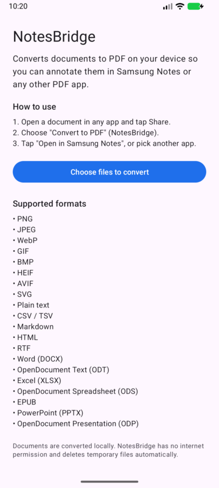
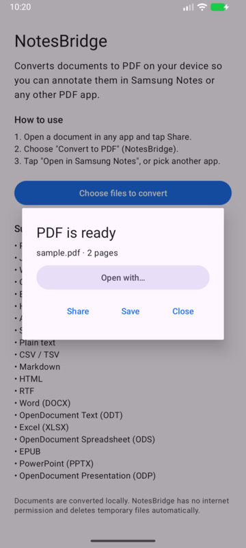
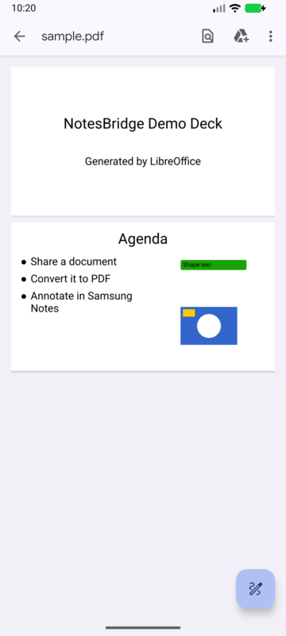

# NotesBridge

[](https://github.com/jvmdevelop/notes-bridge/actions/workflows/ci.yml)
[](https://github.com/jvmdevelop/notes-bridge/releases/latest)
[](LICENSE)

NotesBridge is an Android share target that converts documents to PDF on the device and hands the PDF to Samsung Notes, or to any other app that accepts PDFs.

## Why

Samsung Notes is a good place to annotate documents with the S Pen, but it only imports PDFs and images. Lecture slides, contracts and reports usually arrive as PPTX, DOCX or XLSX, so getting them into Samsung Notes takes a detour through a desktop, an office suite or an online converter. Online converters also mean uploading the document to someone else's server.

NotesBridge closes that gap locally: share the document, get a PDF, open it in Samsung Notes.

## How it works

```
Share → Convert to PDF (NotesBridge) → Open in Samsung Notes
```

| Choose or share a file | PDF is ready | The PDF opened in another app |
| --- | --- | --- |
|  |  |  |

The screenshots were taken on the Android 17 emulator. The emulator has no Samsung Notes, so the third screenshot shows the PDF opened in Google's PDF viewer through the **Open with…** button.

## Features

- Appears in the Android share sheet as **Convert to PDF** and in **Open with** for office formats.
- Converts on the device. The app has no internet permission.
- Several shared files are merged into one PDF, in the order they were shared.
- Text in the PDF stays text: it can be searched, selected and annotated. Fonts are embedded.
- A compact dialog appears only while converting and when the PDF is ready. It offers **Open in Samsung Notes** (when installed), **Open with…**, **Share** and **Save**.
- Conversion runs off the main thread and can be cancelled. Errors are shown in plain language with a technical detail line for bug reports.
- Text shared from other apps (`EXTRA_TEXT`) is converted too.

## Supported formats

The table lists what v0.1.0 actually implements and tests. "Approximate" means that content and structure are kept but the layout is re-flowed by NotesBridge's own renderer, not reproduced pixel by pixel. Details for each format are in [docs/CONVERSION_SUPPORT.md](docs/CONVERSION_SUPPORT.md).

| Format | Status | What is preserved | Main limitations |
| --- | --- | --- | --- |
| PPTX | Supported, approximate | Slide size, text with sizes, colours, bullets and numbering, placeholders inherited from layouts and masters, theme colours, shapes, pictures with cropping, groups, tables, backgrounds | No charts, SmartArt, gradients (first colour only), shadows, effects or animations. Fonts are replaced by Android system fonts |
| DOCX | Supported, approximate | Headings, bold/italic/underline/strike, font sizes and colours, alignment, bulleted and numbered lists, tables, inline images, page breaks, page size and margins | Text is re-flowed. No headers, footers, footnotes, comments, columns, floating object positions or charts |
| XLSX | Supported, data only | All visible sheets as tables, number/date/percent formatting, bold cells | No cell colours, borders, merged cells, charts or print areas. Hidden sheets are skipped |
| ODT | Supported, approximate | Same as DOCX | Same as DOCX |
| ODS | Supported, data only | Same as XLSX | Same as XLSX |
| ODP | Supported, approximate | Text frames, lists, shapes, images, simple tables, backgrounds | Fewer style features than PPTX |
| RTF | Supported, approximate | Text styles, code pages and Unicode, lists, tables, PNG/JPEG pictures, page breaks | WMF/EMF pictures are skipped |
| TXT | Supported | Text with automatic encoding detection (UTF-8/16, Windows-1251, Windows-1252) | Proportional font |
| CSV / TSV | Supported | Table with a repeated header row; delimiter is detected | Very wide tables are shrunk to fit |
| Markdown | Supported | CommonMark plus GitHub tables and strikethrough | Images that point to files or URLs are not loaded |
| HTML | Supported, basic | Headings, text styles, lists, tables, embedded `data:` images, inline styles | No CSS stylesheets, no JavaScript, no remote resources |
| EPUB | Supported, re-flowed | Chapters in reading order, headings, lists, tables, images | DRM-protected books are rejected. Book CSS is ignored |
| PNG, JPEG, WebP, GIF, BMP | Supported | One page per image, EXIF orientation applied | GIF: first frame only |
| HEIF / HEIC, AVIF | Supported where Android decodes them | Same as other images | Depends on the device decoder (HEIF from Android 9, AVIF from Android 12) |
| SVG | Supported | Vector rendering | External references are not loaded |
| DOC, XLS, PPT | **Not supported** | — | Legacy binary Office formats. The app explains how to fix it (save as DOCX/XLSX/PPTX) |
| TIFF | **Not supported** | — | Android has no TIFF decoder |
| Password-protected Office files | **Not supported** | — | Detected and reported |

## Requirements

- Android 8.0 (API 26) or newer.
- Samsung Notes is optional. Without it, the PDF can be opened, shared or saved with any other app.
- About 2 MB of storage for the app.

## Installing the APK

1. Download `NotesBridge-<version>.apk` from the [latest release](https://github.com/jvmdevelop/notes-bridge/releases/latest).
2. Open the file on your phone and allow installation from that source when Android asks.
3. Optional: check the file before installing (see below).

### Verifying the download

Every release lists the APK's SHA-256 checksum and the SHA-256 fingerprint of the signing certificate.

```bash
sha256sum NotesBridge-0.1.0.apk
apksigner verify --print-certs NotesBridge-0.1.0.apk
```

The checksum must match `SHA256SUMS.txt` from the release. The certificate fingerprint must be:

```
05:24:D2:7C:25:5F:80:17:C6:D4:A0:01:5B:68:53:95:0C:F3:96:9D:EE:73:C1:A6:7B:22:9A:D9:0C:91:33:6A
```

All releases are signed with the same key, so Android installs updates over a previous version without uninstalling.

## Building from source

```bash
git clone https://github.com/jvmdevelop/notes-bridge.git
cd notes-bridge
./gradlew assembleDebug
```

You need JDK 25 (the JetBrains Runtime bundled with Android Studio works) and the Android SDK with platform 37. Signing, tests and the full check list are described in [docs/BUILD.md](docs/BUILD.md).

## Usage

- **From another app:** open a document, tap **Share**, choose **Convert to PDF**. When the PDF is ready, tap **Open in Samsung Notes**, or use **Open with…**, **Share** or **Save**.
- **From NotesBridge itself:** tap **Choose files to convert** and pick one or more files.
- **Several files at once:** select them in a file manager and share them together. They end up in one PDF.

Whether Samsung Notes imports the PDF directly or shows its own import screen depends on the Samsung Notes and One UI version. NotesBridge only uses public Android intents (`ACTION_SEND` and `ACTION_VIEW` with a `content://` URI) and makes no assumptions about Samsung Notes internals.

## Architecture

```
ShareReceiverActivity → ShareViewModel → ConversionManager
                                           ├─ FileManager       (copy input to app cache, size limits, clean-up)
                                           ├─ FormatDetector    (magic bytes, ZIP container inspection, MIME, extension)
                                           ├─ ConverterRegistry → PdfExporter implementations
                                           │     readers (DOCX, PPTX, …) → document model → PDF renderer
                                           └─ PdfSink           (android.graphics.pdf.PdfDocument)
NotesLauncher → FileProvider content:// URI → Samsung Notes / chooser
```

Each format reader turns a file into one of two intermediate models: a flowing document (paragraphs, tables, images) or a slide deck (positioned frames). Two renderers turn those models into PDF pages. Adding a format means writing a reader and registering it. See [docs/ARCHITECTURE.md](docs/ARCHITECTURE.md).

## Privacy and security

- No network access: the manifest declares no `INTERNET` permission.
- No storage permissions. Files are read only through the URI grant that comes with the share, and the PDF is shared through `FileProvider` with a temporary read grant.
- Inputs are copied to the app cache, converted and deleted right away. PDFs are deleted after one hour, or earlier when Android clears the cache.
- Macros, scripts and embedded executables are never run. ZIP bombs, deeply nested or oversized documents are rejected by explicit limits.
- Backups and device-to-device transfer are disabled.

Full details: [docs/PRIVACY.md](docs/PRIVACY.md). To report a vulnerability, see [SECURITY.md](SECURITY.md).

## Known limitations

- Office documents are re-rendered by NotesBridge, not by Microsoft Office or LibreOffice. Expect differences in fonts, line breaks and spacing, and missing charts, SmartArt and effects.
- PPTX and DOCX files are tested with files produced by LibreOffice. Files produced by Microsoft Office use more features, and some of them are skipped (the dialog says so).
- The hand-off to Samsung Notes has been tested only up to the system intent. Samsung Notes itself was not available on the test device.
- Very large documents are limited to 100 MB input, 2,000 pages and 100,000 table cells.
- Legacy DOC/XLS/PPT, TIFF and password-protected files are not supported.

## Roadmap

Planned work is in [docs/ROADMAP.md](docs/ROADMAP.md). Highlights: charts and SmartArt fallback images, DOCX headers and footers, cell formatting for spreadsheets, tests with Microsoft Office files, F-Droid packaging.

## Contributing

Bug reports with a sample file (or a description of one) are the most useful contribution. See [CONTRIBUTING.md](CONTRIBUTING.md) and the [Code of Conduct](CODE_OF_CONDUCT.md).

## License

Apache License 2.0, see [LICENSE](LICENSE). Third-party components and their licenses are listed in [legal/THIRD_PARTY_NOTICES.md](legal/THIRD_PARTY_NOTICES.md).

Samsung and Samsung Notes are trademarks of Samsung Electronics Co., Ltd. NotesBridge is an independent project and is not affiliated with or endorsed by Samsung.
